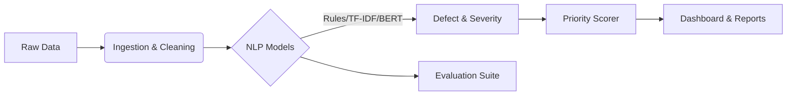

# 🏗️ CiviNLP Triage
### Intelligent Road & Bridge Maintenance Prioritization

[](https://www.python.org/downloads/)
[](https://opensource.org/licenses/MIT)
[](https://streamlit.io)
[](https://github.com/psf/black)

**CiviNLP Triage** is an end-to-end, research-grade NLP decision-support system designed to transform unstructured public maintenance records into actionable intelligence. By leveraging state-of-the-art Natural Language Processing (NLP) and probabilistic modeling, it converts noise (raw text complaints) into signal (prioritized maintenance lists).

---

## 🚀 Key Features

### 🧠 Advanced NLP Modeling
- **Multi-Model Pipeline**: Includes Rule-based baselines, TF-IDF + Logistic Regression, and **DistilBERT Transformer** classifiers.
- **Defect Detection**: Automatically categorizes road issues (e.g., *Potholes*, *Signage*, *Obstructions*) from free-text descriptions.
- **Severity Prediction**: Infers issue severity (High/Medium/Low) using keyword-based heuristics.

### 🛡️ Robust Data Handling
- **PII Redaction**: Built-in privacy protection automatically redacts emails, phone numbers and street addresses from public datasets (names are not detected).
- **Automated Ingestion**: CLI tools to download and normalize **NYC 311 Service Requests** and **NBI Bridge Data**.
- **Schema Validation**: Ensures data integrity with strict Pydantic schemas.

### 📊 Intelligent Prioritization
- **Risk Scoring**: Generates a unified priority score combining defect severity, complaint frequency, repeat rate, and model uncertainty.
- **Uncertainty Calibration & Review Routing**: Temperature scaling with ECE reporting; predictions below a confidence threshold are flagged for manual review (dashboard slider, routing curves in `results/`).
- **Ranking Metrics**: Top-K Recall, NDCG@K, and Spearman correlation for evaluating prioritization quality.

### 🖥️ Interactive Dashboard
A full-featured **Streamlit** UI for operations planners to:
- Visualize top-priority risk zones.
- Run predictions with model selection (Rule / TF-IDF).
- Audit individual predictions with confidence scores.
- Export ranked lists and predictions as CSV.

---

## 🛠️ System Architecture

The system is modularized for reproducibility and extensibility:



---

## 💻 Installation

Clone the repository and install the package with development dependencies:

```bash
git clone https://github.com/raruhan6-ops/CiviNLP-Triage.git
cd CiviNLP-Triage
pip install -e .[dev]
```

---

## ⚡ Quick Start

### 1. Run the End-to-End Pipeline
Execute the full data-to-results pipeline with a single command:
```bash
python scripts/run_pipeline.py
```
*This downloads sample data, preprocesses it, trains baselines, and runs evaluation.*

To also train the transformer model:
```bash
python scripts/run_pipeline.py --transformer
```

### 2. Train Models
Train the baseline and advanced transformer models:
```bash
python scripts/train_models.py --transformer
```

### 3. Launch the Dashboard
Explore the results interactively:
```bash
streamlit run src/civinlp/ui/streamlit_app.py
```

### 4. Launch the API
Start the FastAPI prediction server:
```bash
uvicorn civinlp.api.main:app --reload
```

---

## 📈 Performance & Results

**Classification** is scored against rule-generated weak labels, so it only measures agreement with the rules:

| Model | Task | Macro F1 (vs. weak labels) |
| :--- | :--- | :--- |
| **Rule Baseline** | Defect | 1.00 (by construction) |
| **TF-IDF + LR** | Defect | ~1.00 |
| **TF-IDF + LR** | Severity | ~1.00 |
| **Transformer** | Defect | *Pending* |

Real accuracy needs hand labels: pass a CSV with `record_id`, `defect`, `severity` columns via `--gold`.

**Ranking** is scored against outcomes the rules never see. Areas are ranked using complaints *before* a time cutoff, then graded on what happened *after* it:

- **Volume**: how many new road complaints each area received.
- **Resolution time**: median days to close those complaints (still-open ones count as open until the end of the data; areas with fewer than 3 future complaints are left out).

Example run (20,000 road complaints, Sep 10 to Oct 28, 2026, 193 ZIP areas, cutoff at the time midpoint):

| Ranking | Volume: NDCG@10 | Volume: Spearman | Resolution: NDCG@10 | Resolution: Spearman |
| :--- | :--- | :--- | :--- | :--- |
| Count only (H1) | 0.87 | 0.89 | 0.58 | 0.16 |
| Recency (H2) | 0.49 | 0.45 | 0.28 | 0.05 |
| Severity only (H3) | 0.04 | 0.17 | 0.61 | 0.21 |
| **Priority score** (α=1, β=1) | 0.76 | 0.79 | 0.51 | **0.25** |
| Random | 0.36 | 0.14 | 0.39 | -0.05 |

The two outcomes pull in opposite directions. Past volume best predicts future volume, and more severity weight lowers that score (Spearman 0.89 at β=0, 0.45 at β=4). For resolution time, severity carries the signal, and the combined priority score correlates best. All score terms are scaled to [0, 1], and β=1 is a deliberate middle ground rather than a value tuned to either metric. The full weight sweeps are in `results/ranking_sensitivity*.csv`. Resolution time also reflects complaint-type mix (curb repairs take far longer than street repairs), so treat it as a second proxy, not ground truth.

**Manual review (RQ4)**: predictions below a confidence threshold are routed to a reviewer. `results/routing_*.csv` reports, per threshold, coverage, accuracy of the automated share and the share of model errors caught. Against weak labels the model makes almost no errors, so this curve only becomes informative with `--gold` hand labels.

To reproduce these results, run the ablation suite:
```bash
python scripts/evaluate_all.py
```

---

## 📂 Data

### Obtaining Data
- **NYC 311**: Automatically downloaded via the pipeline (`scripts/run_pipeline.py`). Source: [NYC Open Data](https://data.cityofnewyork.us/resource/erm2-nwe9).
- **NBI Bridge Data**: Download manually from [FHWA](https://www.fhwa.dot.gov/bridge/nbi.cfm), then load and clean with `python -m civinlp.data.download_nbi <path_to_csv>` and `python -m civinlp.data.preprocess_bridges`. Rank bridges in the dashboard (Asset → Bridges).

### What is Stored
- **Processed data**: Parquet files with PII-redacted text. No raw personal information is retained.
- **Models**: Trained model weights (TF-IDF `.joblib`, DistilBERT `.safetensors`).
- **Results**: Ablation tables, error analysis, and evaluation summaries.

### What is NOT Stored
- Raw personal identifiers (emails, phone numbers, street addresses — redacted before saving).
- Full NYC 311 dataset (only a sample is downloaded; configurable via `--limit`).

---

## 📖 Documentation

| Document | Description |
|:---|:---|
| [DATA_DICTIONARY.md](docs/DATA_DICTIONARY.md) | All fields, types, and derivations |
| [LABEL_GUIDE.md](docs/LABEL_GUIDE.md) | Defect taxonomy and severity definitions |
| [MODEL_CARD.md](docs/MODEL_CARD.md) | Model details, metrics, caveats, biases |
| [ETHICS_AND_LIMITATIONS.md](docs/ETHICS_AND_LIMITATIONS.md) | Fairness, reporting bias, responsible use |
| [REPRODUCIBILITY.md](docs/REPRODUCIBILITY.md) | Exact commands, seeds, expected outputs |

---

## ⚠️ Limitations & Responsible Use

> **This tool is decision-support only and does not replace engineering judgment.**

- Models are trained on **weak labels** (keyword-derived), not human annotations.
- 311 complaint data reflects **reporting patterns**, not ground truth conditions.
- Priority rankings should be **cross-referenced** with field inspection data.
- See [ETHICS_AND_LIMITATIONS.md](docs/ETHICS_AND_LIMITATIONS.md) for full details.

---

## 🤝 Contributing

Contributions are welcome! Please run the test suite before submitting a PR:

```bash
pytest tests/ -v
```

## 📄 License

This project is licensed under the [MIT License](LICENSE). 
