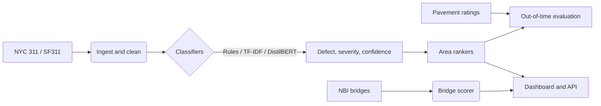

# CiviNLP Triage

**Out-of-time evaluation of 311 road-maintenance triage, with a reproducible ranking pipeline, dashboard and API.**

[](https://github.com/raruhan6-ops/CiviNLP-Triage/actions/workflows/ci.yaml)
[](https://www.python.org/downloads/)
[](LICENSE)

CiviNLP Triage ranks areas of a city by where road maintenance is likely needed, from public 311 complaint records. It labels each complaint with a defect type and a rule-based severity, aggregates complaints by zip code, neighbourhood or 500 m grid cell, and ranks areas by volume, severity and complaint mix.

The project's main contribution is how those rankings are evaluated. Triage models are often scored against labels produced by the same keyword rules that feed them, which is circular: here every classifier reaches a Macro F1 of 1.0 against such labels. Instead, CiviNLP Triage grades each ranking only on outcomes the rules never see, observed *after* a time cutoff:

| Outcome | Source |
|:---|:---|
| Future complaint volume | 311 complaints in the next window |
| Resolution time | Median days to close those complaints |
| Confirmed-defect share | DOT resolution text, mapped to verdicts by a reviewed template table |
| Pavement condition and its change | Street pavement ratings from city inspectors, independent of 311 |

Rankings are compared over rolling folds with moving-block bootstrap intervals, adjusted for multiple comparisons.

## Findings

On 298,193 NYC 311 road complaints (November 2024 to November 2026, 17 test folds), with a replication on 155,148 San Francisco requests (2016 to 2025, six annual test folds):

- **Complaint volume is hard to beat.** Counting past complaints is the best simple ranker of future volume (Spearman 0.876 by NYC zip code, 0.929 by San Francisco neighbourhood), and severity adds nothing to it.
- **Rule-based severity adds little beyond complaint type.** For resolution time, type adds +0.112 (zip) and +0.105 (grid) on top of severity, while severity adds +0.034 (an interval including zero) and +0.006 on top of type.
- **Against measured pavement condition**, complaint type carries what signal there is. Severity adds nothing by zip code or neighbourhood and slightly lowers a type-aware ranking by grid cell, in both cities. No ranker predicts how ratings change.
- **The descriptor mix**, which severity compresses, ranks confirmed defects best by grid cell.

Severity here is a fixed relabelling of two categorical fields (complaint type and descriptor), so these results test rule-based severity, not language understanding. The accompanying paper gives the full design, results and limitations.

## Installation

Requires Python 3.11 or later.

```bash
git clone https://github.com/raruhan6-ops/CiviNLP-Triage.git
cd CiviNLP-Triage
python -m venv .venv
source .venv/bin/activate      # Windows: .venv\Scripts\activate
pip install -e .[dev]
```

## Reproducing the paper

The datasets are public and are downloaded by the pipeline; they are not redistributed. The main steps:

```bash
# NYC 311 road complaints (two years) and DOT pavement ratings
python -m civinlp.data.download_roads_311 --monthly --since 2024-11-01 --until 2026-11-02 \
    --output data_raw/roads_311_2y_res.parquet
python -m civinlp.data.preprocess_roads --input data_raw/roads_311_2y_res.parquet \
    --output data_processed/roads_processed_2y_res.parquet
python -m civinlp.data.pavement

# Rolling out-of-time evaluation, by zip code and by 500 m grid cell
python scripts/rolling_eval.py --data data_processed/roads_processed_2y_res.parquet --area zip --output_dir results/rolling/
python scripts/rolling_eval.py --data data_processed/roads_processed_2y_res.parquet --area grid --cell_m 500 --output_dir results/rolling/
python scripts/simultaneous_intervals.py --output_dir results/rolling/

# San Francisco replication
python -m civinlp.data.sf
```

[docs/REPRODUCIBILITY.md](docs/REPRODUCIBILITY.md) lists every command, including the pavement, zip-code and San Francisco runs, the verdict checks and which output file backs each table.

## The tool

### Pipeline



- **Classification:** keyword rules, TF-IDF with logistic regression, and an optional DistilBERT classifier, for defect type (pothole, cracking, street condition, obstruction, signage, other) and severity (high, medium, low). The models are trained on rule-generated labels, so their scores against those labels measure agreement with the rules only.
- **Ranking:** count, recency and severity baselines; a weighted priority score; and ridge rankers on volume, severity, complaint-type and descriptor features, with the penalty chosen on tuning folds.
- **Review routing:** predictions below a confidence threshold are flagged for manual review.
- **Bridges:** a separate scorer ranks bridges from National Bridge Inventory condition ratings and traffic. It is not part of the evaluation.

### Dashboard and API

```bash
python scripts/run_pipeline.py --limit 20000         # download a recent sample, train, evaluate
streamlit run src/civinlp/ui/streamlit_app.py        # dashboard
uvicorn civinlp.api.main:app --reload                # API
```

| Endpoint | Purpose |
|:---|:---|
| `POST /predict/roads` | Defect, severity and confidence for a batch of texts |
| `POST /predict/bridges` | Severity and priority for a batch of bridges |
| `POST /rank` | Ranked road areas and/or bridges |
| `GET /health` | Status and loaded models |

The API is open by default for local use. Set `CIVINLP_API_KEY` to require an `X-API-Key` header, and `CIVINLP_MAX_BATCH` to change the per-request limit (default 1,000).

## Project structure

```
src/civinlp/
  data/      Downloads and preprocessing: NYC 311, DOT pavement ratings (pavement.py),
             San Francisco 311 and pavement (sf.py), NBI bridges, splits, schemas
  labels/    Defect taxonomy and keyword rules
  models/    Rules, TF-IDF, DistilBERT, calibration
  ranking/   Road and bridge priority scorers
  eval/      Rolling out-of-time evaluation, outcomes, bootstrap intervals,
             classification, ranking and routing metrics
  api/  ui/  FastAPI service and Streamlit dashboard
  utils/     I/O, text cleaning, PII redaction, logging, seeds
scripts/     Pipeline, training, rolling evaluation, simultaneous intervals,
             verdict sensitivity and agreement
docs/        Reproducibility guide, data dictionary, label guide, verdict table
paper/       Paper and verdict-review sheets
tests/       pytest suite
```

## Data

| Dataset | Publisher | Use |
|:---|:---|:---|
| [311 Service Requests](https://data.cityofnewyork.us/d/erm2-nwe9) | NYC Open Data | Road complaints and DOT resolution text |
| [Street Pavement Ratings](https://data.cityofnewyork.us/d/6yyb-pb25) | NYC DOT | Pavement outcome |
| [311 Cases](https://data.sfgov.org/d/vw6y-z8j6) | DataSF | San Francisco road defect requests |
| [Historical Pavement Condition Index](https://data.sfgov.org/d/78va-8dhi) | San Francisco Public Works | San Francisco pavement outcome |
| [National Bridge Inventory](https://www.fhwa.dot.gov/bridge/nbi.cfm) | FHWA | Bridge scorer (downloaded manually) |

Downloaded and processed files (`data_raw/`, `data_processed/`), model weights (`models/`) and results (`results/`) are gitignored. Open-data records change over time, so a later download can differ from ours. Emails, phone numbers and street addresses are redacted before text is saved; personal names are not detected, which is adequate only for the structured fields used here.

## Documentation

| Document | Contents |
|:---|:---|
| [REPRODUCIBILITY.md](docs/REPRODUCIBILITY.md) | Every command, seed and output file behind the paper |
| [DATA_DICTIONARY.md](docs/DATA_DICTIONARY.md) | Raw, processed and derived fields for each dataset |
| [LABEL_GUIDE.md](docs/LABEL_GUIDE.md) | Defect and severity definitions; DOT verdict definitions for raters |
| [verdict_mapping.csv](docs/verdict_mapping.csv) | Template-to-verdict table behind the confirmed-defect outcome |

## Limitations and responsible use

This is a decision-support prototype. It does not replace engineering judgment or field inspection.

- **Reporting bias.** 311 volume reflects who reports as well as where defects are, so ranking by volume can direct attention to areas that report more. Rankings are not normalised for population or road length, and fairness across areas is not evaluated.
- **Proxy outcomes.** Future volume, resolution time and confirmed share are proxies for need. Pavement ratings measure condition directly but only for the segments inspectors rate in each window.
- **Verdict rules.** The confirmed-defect labels come from phrase rules on templated text, cover 64% of NYC complaints, and have been checked only by the co-author who reviewed them.
- **Short input.** The public 311 fields contain no citizen narrative, only short categorical text.
- **Two cities.** The San Francisco panel has six annual folds, and the NYC severity rules mark only collapsed sidewalks as high there.

## Running the checks

The same checks as CI:

```bash
ruff check src/ scripts/ tests/
black --check src/ scripts/ tests/
pytest tests/ -v --ignore=tests/test_advanced_models.py
```

`tests/test_advanced_models.py` needs the transformer dependencies and a model download.

## Citation

If you use this software, please cite it using the metadata in [CITATION.cff](CITATION.cff).

## License

[MIT](LICENSE)
