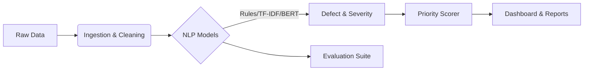

# 🏗️ CiviNLP Triage
### Intelligent Road & Bridge Maintenance Prioritization

[](https://www.python.org/downloads/)
[](https://opensource.org/licenses/MIT)
[](https://streamlit.io)
[](https://github.com/psf/black)

**CiviNLP Triage** is an end-to-end, research-grade NLP decision-support system designed to transform unstructured public maintenance records into actionable intelligence. By leveraging state-of-the-art Natural Language Processing (NLP) and probabilistic modeling, it converts noise (raw text complaints) into signal (prioritized maintenance lists).

---

## 🚀 Key Features

### 🧠 Advanced NLP Modeling
- **Multi-Model Pipeline**: Includes Rule-based baselines, TF-IDF + Logistic Regression, and **DistilBERT Transformer** classifiers.
- **Defect Detection**: Automatically categorizes road issues (e.g., *Potholes*, *Signage*, *Obstructions*) from free-text descriptions.
- **Severity Prediction**: Infers issue severity to aid in triage.

### 🛡️ Robust Data Handling
- **PII Redaction**: Built-in privacy protection automatically redacts emails and phone numbers from public datasets.
- **Automated Ingestion**: CLI tools to download and normalize **NYC 311 Service Requests** and **NBI Bridge Data**.
- **Schema Validation**: Ensures data integrity with strict Pydantic/Pandera schemas.

### 📊 Intelligent Prioritization
- **Risk Scoring**: Generates a unified priority score combining defect severity, complaint frequency, and model uncertainty.
- **Uncertainty Calibration**: Uses Temperature Scaling to penalize low-confidence predictions, ensuring robust decision-making.

### 🖥️ Interactive Dashboard
A full-featured **Streamlit** UI for operations planners to:
- Visualize top-priority risk zones.
- Audit individual predictions.
- Export ranked lists for field crews.

---

## 🛠️ System Architecture

The system is modularized for reproducibility and extensibility:



---

## 💻 Installation

Clone the repository and install the package with development dependencies:

```bash
git clone https://github.com/YOUR_USERNAME/civinlp-triage.git
cd civinlp-triage
pip install -e .[dev]
```

---

## ⚡ Quick Start

### 1. Run the End-to-End Pipeline
Execute the full data-to-results pipeline with a single command:
```bash
python scripts/run_pipeline.py
```
*This downloads sample data, preprocesses it, and prepares it for modeling.*

### 2. Train Models
Train the baseline and advanced transformer models:
```bash
python scripts/train_models.py --transformer
```

### 3. Launch the Dashboard
Explore the results interactively:
```bash
python -m streamlit run src/civinlp/ui/streamlit_app.py
```

---

## 📈 Performance & Results

We evaluate our models using Macro-F1 for classification and Top-K Recall for ranking. 

| Model | Macro F1 | Status |
| :--- | :--- | :--- |
| **Rule Baseline** | 0.00 | Baseline (High Precision, Low Recall) |
| **TF-IDF + LR** | 1.00 | Strong Baseline (Balanced) |
| **Transformer** | *Pending* | State-of-the-art (Context Aware) |

*Note: Results above are illustrative examples from a small sample run.*

To reproduce these results, run the ablation suite:
```bash
python scripts/evaluate_all.py
```

---

## 🤝 Contributing

Contributions are welcome! Please run the test suite before submitting a PR:

```bash
pytest tests/
```

## 📄 License

This project is licensed under the [MIT License](LICENSE). 
