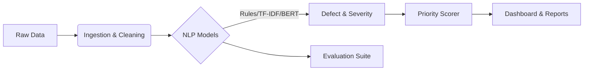

# 🏗️ CiviNLP Triage
### Intelligent Road & Bridge Maintenance Prioritization

[](https://www.python.org/downloads/)
[](https://opensource.org/licenses/MIT)
[](https://streamlit.io)
[](https://github.com/psf/black)

**CiviNLP Triage** is an end-to-end, research-grade NLP decision-support system designed to transform unstructured public maintenance records into actionable intelligence. By leveraging state-of-the-art Natural Language Processing (NLP) and probabilistic modeling, it converts noise (raw text complaints) into signal (prioritized maintenance lists).

---

## 🚀 Key Features

### 🧠 Advanced NLP Modeling
- **Multi-Model Pipeline**: Includes Rule-based baselines, TF-IDF + Logistic Regression, and **DistilBERT Transformer** classifiers.
- **Defect Detection**: Automatically categorizes road issues (e.g., *Potholes*, *Signage*, *Obstructions*) from free-text descriptions.
- **Severity Prediction**: Infers issue severity (High/Medium/Low) using keyword-based heuristics.

### 🛡️ Robust Data Handling
- **PII Redaction**: Built-in privacy protection automatically redacts emails and phone numbers from public datasets.
- **Automated Ingestion**: CLI tools to download and normalize **NYC 311 Service Requests** and **NBI Bridge Data**.
- **Schema Validation**: Ensures data integrity with strict Pydantic schemas.

### 📊 Intelligent Prioritization
- **Risk Scoring**: Generates a unified priority score combining defect severity, complaint frequency, repeat rate, and model uncertainty.
- **Uncertainty Calibration**: Uses Temperature Scaling to penalize low-confidence predictions, ensuring robust decision-making.
- **Ranking Metrics**: Top-K Recall, NDCG@K, and Spearman correlation for evaluating prioritization quality.

### 🖥️ Interactive Dashboard
A full-featured **Streamlit** UI for operations planners to:
- Visualize top-priority risk zones.
- Run predictions with model selection (Rule / TF-IDF).
- Audit individual predictions with confidence scores.
- Export ranked lists and predictions as CSV.

---

## 🛠️ System Architecture

The system is modularized for reproducibility and extensibility:



---

## 💻 Installation

Clone the repository and install the package with development dependencies:

```bash
git clone https://github.com/YOUR_USERNAME/civinlp-triage.git
cd civinlp-triage
pip install -e .[dev]
```

---

## ⚡ Quick Start

### 1. Run the End-to-End Pipeline
Execute the full data-to-results pipeline with a single command:
```bash
python scripts/run_pipeline.py
```
*This downloads sample data, preprocesses it, trains baselines, and runs evaluation.*

To also train the transformer model:
```bash
python scripts/run_pipeline.py --transformer
```

### 2. Train Models
Train the baseline and advanced transformer models:
```bash
python scripts/train_models.py --transformer
```

### 3. Launch the Dashboard
Explore the results interactively:
```bash
streamlit run src/civinlp/ui/streamlit_app.py
```

### 4. Launch the API
Start the FastAPI prediction server:
```bash
uvicorn civinlp.api.main:app --reload
```

---

## 📈 Performance & Results

We evaluate our models using Macro-F1 for classification and Top-K Recall for ranking. 

| Model | Task | Macro F1 | Status |
| :--- | :--- | :--- | :--- |
| **Rule Baseline** | Defect | ~1.00 | Baseline (keyword match) |
| **TF-IDF + LR** | Defect | ~1.00 | Strong Baseline (trained on weak labels) |
| **TF-IDF + LR** | Severity | ~1.00 | Severity classification |
| **Transformer** | Defect | *Pending* | State-of-the-art (context-aware) |

*Note: High F1 scores are expected when evaluating against weak labels (rule-generated ground truth). True performance requires human-annotated test data.*

To reproduce these results, run the ablation suite:
```bash
python scripts/evaluate_all.py
```

---

## 📂 Data

### Obtaining Data
- **NYC 311**: Automatically downloaded via the pipeline (`scripts/run_pipeline.py`). Source: [NYC Open Data](https://data.cityofnewyork.us/resource/erm2-nwe9).
- **NBI Bridge Data**: Download manually from [FHWA](https://www.fhwa.dot.gov/bridge/nbi.cfm), then load with `python -m civinlp.data.download_nbi <path_to_csv>`.

### What is Stored
- **Processed data**: Parquet files with PII-redacted text. No raw personal information is retained.
- **Models**: Trained model weights (TF-IDF `.joblib`, DistilBERT `.safetensors`).
- **Results**: Ablation tables, error analysis, and evaluation summaries.

### What is NOT Stored
- Raw personal identifiers (emails, phone numbers — redacted before saving).
- Full NYC 311 dataset (only a sample is downloaded; configurable via `--limit`).

---

## 📖 Documentation

| Document | Description |
|:---|:---|
| [DATA_DICTIONARY.md](docs/DATA_DICTIONARY.md) | All fields, types, and derivations |
| [LABEL_GUIDE.md](docs/LABEL_GUIDE.md) | Defect taxonomy and severity definitions |
| [MODEL_CARD.md](docs/MODEL_CARD.md) | Model details, metrics, caveats, biases |
| [ETHICS_AND_LIMITATIONS.md](docs/ETHICS_AND_LIMITATIONS.md) | Fairness, reporting bias, responsible use |
| [REPRODUCIBILITY.md](docs/REPRODUCIBILITY.md) | Exact commands, seeds, expected outputs |

---

## ⚠️ Limitations & Responsible Use

> **This tool is decision-support only and does not replace engineering judgment.**

- Models are trained on **weak labels** (keyword-derived), not human annotations.
- 311 complaint data reflects **reporting patterns**, not ground truth conditions.
- Priority rankings should be **cross-referenced** with field inspection data.
- See [ETHICS_AND_LIMITATIONS.md](docs/ETHICS_AND_LIMITATIONS.md) for full details.

---

## 🤝 Contributing

Contributions are welcome! Please run the test suite before submitting a PR:

```bash
pytest tests/ -v
```

## 📄 License

This project is licensed under the [MIT License](LICENSE). 
