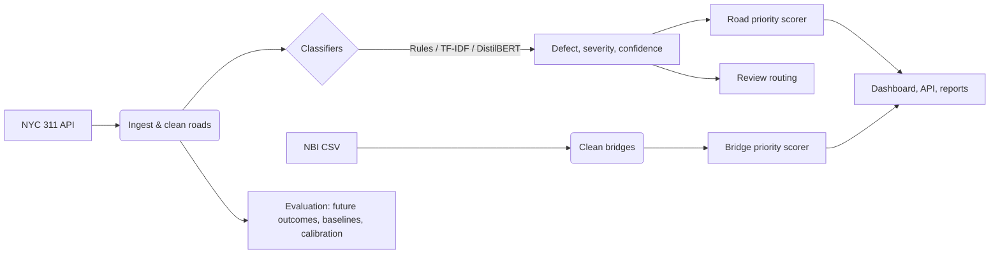

# 🏗️ CiviNLP Triage
### Road & Bridge Maintenance Prioritization from Public Records

[](https://github.com/raruhan6-ops/CiviNLP-Triage/actions/workflows/ci.yaml)
[](https://www.python.org/downloads/)
[](https://opensource.org/licenses/MIT)
[](https://streamlit.io)
[](https://github.com/psf/black)

**CiviNLP Triage** is a reproducible decision-support tool that turns public maintenance records into a ranked list of where to look first. It classifies NYC 311 road complaints by defect type and severity, scores bridges from National Bridge Inventory (NBI) condition ratings, and combines these into priority rankings. The rankings are evaluated against what actually happened afterwards, not against the rules that produced them.

---

## 🚀 Key Features

### 🧠 Classification
- **Three model tiers**: keyword rules, TF-IDF + Logistic Regression, and a DistilBERT classifier.
- **Defect type**: pothole, cracking, street condition, obstruction, signage, other.
- **Severity**: high / medium / low from whole-word keyword rules (e.g. *cave-in*, *dangerous* → high; *cracked*, *broken* → medium).
- **Input**: the 311 `complaint_type` and `descriptor` fields. The public NYC 311 data has no free-text narrative, so models work on these short structured descriptions.

### 🛡️ Data Handling
- **Road-only ingestion**: downloads only road-related complaint types (street, highway, curb and sidewalk conditions; street signs), in pages with retries and timeouts.
- **Clean area IDs**: ZIP codes normalised to 5 digits.
- **Bridge preprocessing**: maps NBI items (`DECK_COND_058`, ...) to internal fields, handles `N`/missing ratings, converts coordinates.
- **PII redaction**: emails, phone numbers and street addresses are redacted before saving (names are not detected).
- **Leakage-aware splits**: chronological, held-out zones, or by bridge ID.

### 📊 Prioritization
- **Road priority score**: `α·count + β·severity + γ·repeat_rate − δ·uncertainty`, with every term scaled to [0, 1] so the weights are comparable.
- **Bridge priority score**: worst condition rating plus log-scaled traffic.
- **Manual-review routing**: predictions below a confidence threshold are flagged for a human reviewer.
- **Calibration**: temperature scaling with Expected Calibration Error (ECE) before and after.

### 🖥️ Dashboard & API
- **Streamlit dashboard**: road predictions with confidence and review flags, area rankings, a bridge ranking view, and CSV export.
- **FastAPI service**: batch prediction and ranking endpoints, an optional API key, and a batch-size cap.

---

## 🛠️ System Architecture



---

## 💻 Installation

Requires Python 3.11+.

```bash
git clone https://github.com/raruhan6-ops/CiviNLP-Triage.git
cd CiviNLP-Triage
python -m venv .venv
source .venv/bin/activate      # Windows: .venv\Scripts\activate
pip install -e .[dev]
```

---

## ⚡ Quick Start

### 1. Run the full pipeline
Download, preprocess, train the TF-IDF models and evaluate:
```bash
python scripts/run_pipeline.py --limit 20000
```
The default `--limit` is 1,000 rows. Use around 20,000 so the evaluation's history and future windows each span a few weeks. Add `--transformer` to also fine-tune DistilBERT (slow without a GPU).

### 2. Launch the dashboard
```bash
streamlit run src/civinlp/ui/streamlit_app.py
```
Choose **Asset → Roads** or **Bridges** in the sidebar. The "Manual review below confidence" slider sets the review threshold.

### 3. Launch the API
```bash
uvicorn civinlp.api.main:app --reload
```

| Endpoint | Purpose |
|:---|:---|
| `POST /predict/roads` | Defect, severity and confidence for a batch of texts |
| `POST /predict/bridges` | Severity and priority for a batch of bridges |
| `POST /rank` | Ranked road areas and/or bridges |
| `GET /health` | Status and loaded models |

The API is open by default for local use. Set `CIVINLP_API_KEY` to require an `X-API-Key` header, and `CIVINLP_MAX_BATCH` to change the per-request limit (default 1,000).

### 4. Bridges
Download a state's delimited NBI file from [FHWA](https://www.fhwa.dot.gov/bridge/nbi.cfm), then:
```bash
python -m civinlp.data.download_nbi path/to/nbi.csv --output data_raw/bridges_nbi.parquet
python -m civinlp.data.preprocess_bridges
```
Alternatively, upload the NBI CSV directly in the dashboard's Bridges view.

---

## 📈 Evaluation & Results

```bash
python scripts/evaluate_all.py                    # chronological split
python scripts/evaluate_all.py --split area       # hold out 20% of zones
python scripts/evaluate_all.py --gold labels.csv  # also score against hand labels
```

Results are written to `results/`; see [REPRODUCIBILITY.md](docs/REPRODUCIBILITY.md) for the full list.

### Classification

The training labels come from the keyword rules, so F1 against them only measures **agreement with the rules**:

| Model | Task | Macro F1 (vs. weak labels) |
| :--- | :--- | :--- |
| Rule Baseline | Defect | 1.00 (by construction) |
| TF-IDF + LR | Defect | ~1.00 |
| TF-IDF + LR | Severity | ~1.00 |
| DistilBERT | Defect | *not yet trained on current data* |

Real accuracy, calibration and the review-routing trade-off need hand labels. Pass a CSV with `record_id` plus `defect` and/or `severity` columns via `--gold`.

### Ranking

Rankings are scored against outcomes the rules never see. Areas are ranked using complaints **before** a time cutoff, then graded on what happened **after** it:

- **Volume**: how many new road complaints each area received.
- **Resolution time**: median days to close those complaints (still-open ones count as open until the end of the data; areas with fewer than 3 future complaints are left out).

Example run (20,000 road complaints, Sep 10 to Oct 28, 2026, 193 ZIP areas, cutoff at the time midpoint):

| Ranking | Volume: NDCG@10 | Volume: Spearman | Resolution: NDCG@10 | Resolution: Spearman |
| :--- | :--- | :--- | :--- | :--- |
| Count only (H1) | 0.87 | **0.89** | 0.58 | 0.16 |
| Recency (H2) | 0.49 | 0.45 | 0.28 | 0.05 |
| Severity only (H3) | 0.04 | 0.17 | 0.61 | 0.21 |
| **Priority score** (α=1, β=1) | 0.76 | 0.79 | 0.51 | **0.25** |
| Random | 0.36 | 0.14 | 0.39 | -0.05 |

The two outcomes pull in opposite directions:

- **Volume**: past volume is the best predictor of future volume, and more severity weight lowers that score (Spearman 0.89 at β=0, 0.45 at β=4).
- **Resolution time**: severity carries the signal, and the combined priority score correlates best.

β=1 is a deliberate middle ground, not a value tuned to either metric. The full weight sweeps are in `results/ranking_sensitivity*.csv`. Resolution time also reflects complaint-type mix (curb repairs take far longer than street repairs), so treat it as a second proxy, not ground truth.

### Manual review

`results/routing_*.csv` reports, for each confidence threshold:
- the share of predictions handled automatically,
- the accuracy of that automated share,
- the share of model errors sent to review.

Against weak labels the model makes almost no errors, so this curve becomes informative only with `--gold` hand labels.

---

## 📂 Project Structure

```
configs/            Road and bridge settings (weights, model parameters)
docs/               Data dictionary, label guide, model card, ethics, reproducibility
scripts/            run_pipeline.py, train_models.py, evaluate_all.py
src/civinlp/
  data/             311 download, NBI loading, preprocessing, splits, schemas
  labels/           Taxonomy and keyword rules
  models/           Rules, TF-IDF, DistilBERT, calibration
  ranking/          Road and bridge priority scorers
  eval/             Classification, ranking, outcome and routing evaluation
  api/  ui/         FastAPI service and Streamlit dashboard
  utils/            I/O, text cleaning, PII redaction, logging, seeds
tests/              pytest suite
```

---

## 📂 Data

### Sources
- **NYC 311 Service Requests**: [NYC Open Data](https://data.cityofnewyork.us/resource/erm2-nwe9), downloaded by the pipeline. The API returns the most recent requests, so results depend on the download date.
- **National Bridge Inventory**: [FHWA](https://www.fhwa.dot.gov/bridge/nbi.cfm), downloaded manually.

### What is stored
- **Raw and processed Parquet files** (`data_raw/`, `data_processed/`, gitignored). Only the needed 311 columns are downloaded: IDs, dates, status, complaint type, descriptor, ZIP code, borough and coordinates.
- **Model files** (`models/`, gitignored).
- **Evaluation outputs** (`results/`, gitignored).

### What is not stored
- Emails, phone numbers or street addresses in model text (redacted before saving).
- The full NYC 311 dataset (only a recent sample; set the size with `--limit`).

---

## 📖 Documentation

| Document | Description |
|:---|:---|
| [DATA_DICTIONARY.md](docs/DATA_DICTIONARY.md) | Fields, types and derivations |
| [LABEL_GUIDE.md](docs/LABEL_GUIDE.md) | Defect taxonomy and severity definitions |
| [MODEL_CARD.md](docs/MODEL_CARD.md) | Model details, metrics, caveats, biases |
| [ETHICS_AND_LIMITATIONS.md](docs/ETHICS_AND_LIMITATIONS.md) | Fairness, reporting bias, responsible use |
| [REPRODUCIBILITY.md](docs/REPRODUCIBILITY.md) | Exact commands, seeds, expected outputs |

---

## ⚠️ Limitations & Responsible Use

> **This tool supports decisions; it does not replace engineering judgment or field inspection.**

- **Weak labels**: models are trained on keyword-derived labels, not human annotations. Classification scores against them are not real-world accuracy.
- **Short structured input**: the input is complaint type plus descriptor, not free-text narratives.
- **Reporting bias**: 311 data reflects who reports problems, not the true condition of every street. Areas that report less can be under-prioritized.
- **Proxy outcomes**: future complaint volume and resolution time are proxies for need, not ground truth.
- **Bridges**: the bridge pipeline is tested on NBI-format sample rows; validate it on a full state file before relying on it.
- See [ETHICS_AND_LIMITATIONS.md](docs/ETHICS_AND_LIMITATIONS.md) for details.

---

## 🤝 Contributing

Contributions are welcome. Before opening a pull request, run the same checks as CI:

```bash
ruff check src/ scripts/ tests/
black --check src/ scripts/ tests/
pytest tests/ -v --ignore=tests/test_advanced_models.py
```

## 📄 License

This project is licensed under the [MIT License](LICENSE).
